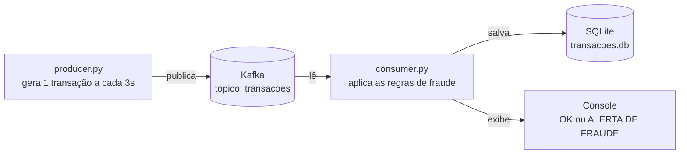

# TDE 03 – Detecção de Fraude com Apache Kafka

Um **producer** gera transações aleatórias (uma a cada 3 segundos) e publica no Kafka.
Um **consumer** lê essas transações, aplica as regras de fraude, salva tudo em um banco
SQLite e mostra no console se a transação está OK ou se é uma fraude.

## Como funciona



## Padrão da transação

```json
{
  "transaction_id": "3bb7d9f2-8757-4553-a829-5d20846e358e",
  "client_id": "cliente_5",
  "amount": 1994.97,
  "city": "São Paulo",
  "timestamp": "2026-10-13T18:35:07"
}
```

## Regras de fraude

| Fraude       | Regra                                                                 |
|--------------|-----------------------------------------------------------------------|
| `ALTO_VALOR` | Transação com `amount >= 10000`                                       |
| `TEMPO_60s`  | Mesmo cliente com 4 transações em menos de 60 segundos                |
| `GEO_10m`    | Mesmo cliente com 2 transações em cidades diferentes em até 10 minutos |

Uma transação pode ter mais de uma fraude ao mesmo tempo (ex: `TEMPO_60s, GEO_10m`).

## Tecnologias

- Python 3 + biblioteca `kafka-python`
- Apache Kafka 3.9 (rodando no Docker, modo KRaft, sem Zookeeper)
- SQLite (banco em arquivo, já vem com o Python)

## Como rodar

Pré-requisitos: **Docker Desktop** aberto e **Python 3** instalado.

```bash
# 1. Subir o Kafka
docker compose up -d

# 2. Instalar a biblioteca do Kafka para Python
pip install -r requirements.txt

# 3. Terminal 1: iniciar o consumer
python consumer.py

# 4. Terminal 2: iniciar o producer
python producer.py

# 5. (Opcional) Ver o que foi salvo no banco
python consultar_banco.py
```

Para parar: `Ctrl+C` nos terminais e depois `docker compose down -v`
(o `-v` apaga também os volumes do Kafka, para não deixar lixo no Docker).

## Exemplo de saída do consumer

```
[OK]               2026-10-13T18:34:58 | cliente_19 | R$   4946.74 | São Paulo
[ALERTA DE FRAUDE] 2026-10-13T18:35:04 | cliente_8  | R$   2321.12 | Rio de Janeiro  -->  GEO_10m
[ALERTA DE FRAUDE] 2026-10-13T18:35:07 | cliente_5  | R$   1994.97 | São Paulo  -->  TEMPO_60s, GEO_10m
[OK]               2026-10-13T18:35:10 | cliente_20 | R$   2474.60 | Curitiba
[ALERTA DE FRAUDE] 2026-10-13T18:35:19 | cliente_13 | R$  28417.58 | São Paulo  -->  ALTO_VALOR
```

## Estrutura do projeto

```
├── docker-compose.yml   # sobe o Kafka
├── requirements.txt     # dependência Python (kafka-python)
├── producer.py          # gera e publica as transações
├── consumer.py          # lê, detecta fraude, salva no banco e exibe
└── consultar_banco.py   # mostra os dados salvos no banco
```
